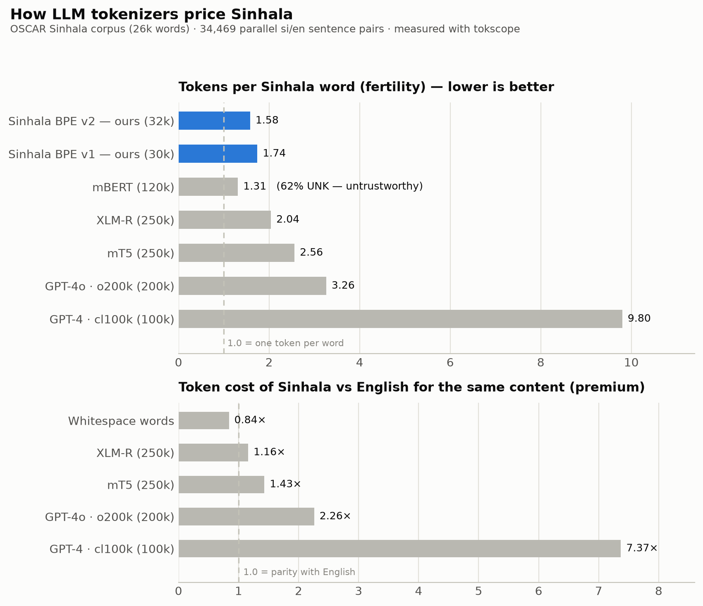

# How LLM tokenizers price Sinhala

*A case study run with [tokscope](https://github.com/RavinduPabasara/tokscope), July 2026.*



## Question

Sinhala (~20M speakers) is a low-resource language. When mainstream LLM
tokenizers process Sinhala text, how efficiently do they encode it — and what
does that cost Sinhala speakers relative to English speakers?

## Data

- **Monolingual**: a sample of the deduplicated [OSCAR](https://oscar-project.org/)
  Sinhala corpus (1,500 lines ≈ 26,000 words), cleaned with the pipeline in
  [SinhalaCustomTokenizer](https://github.com/RavinduPabasara/SinhalaCustomTokenizer).
- **Parallel**: 34,469 Sinhala–English sentence pairs, used to compute the
  **token premium** — the ratio of tokens needed for the same content in
  Sinhala vs English under the same tokenizer.

## Results

### Fertility (tokens per word, OSCAR Sinhala — lower is better)

| Tokenizer | Vocab | Fertility | UNK rate |
|---|---|---|---|
| **Sinhala BPE v2 (ours)** | 32k | **1.58** | 0.0007 |
| Sinhala BPE v1 (ours) | 30k | 1.74 | 0.107 |
| mBERT | 120k | 1.31* | **0.62** ⚠️ |
| XLM-R | 250k | 2.04 | 0 |
| mT5 | 250k | 2.56 | 0 |
| GPT-4o (o200k) | 200k | 3.26 | 0 |
| GPT-4 (cl100k) | 100k | 9.80 | 0 |

\* mBERT's fertility looks good only because it replaces **62% of tokens with
`[UNK]`** — it deletes most of the language rather than encoding it. Fertility
is only meaningful alongside UNK rate.

### Token premium (Sinhala ÷ English tokens for the same content, 34,469 parallel pairs)

| Tokenizer | Premium |
|---|---|
| Whitespace words (reference) | 0.84× |
| XLM-R | 1.16× |
| mT5 | 1.43× |
| GPT-4o (o200k) | 2.26× |
| GPT-4 (cl100k) | **7.37×** |

## Findings

1. **Sinhala pays a token tax.** In *words*, Sinhala is more compact than
   English (0.84×) — yet after tokenization the same content costs 2.26× more
   tokens on GPT-4o, and 7.37× more on the original GPT-4 tokenizer. Token
   costs translate directly to API pricing and context-window capacity: a
   Sinhala speaker gets a fraction of the effective context an English speaker
   gets from the same model.
2. **cl100k → o200k was a 3× improvement for Sinhala** (9.80 → 3.26 fertility),
   showing vendors *can* fix this when vocabularies grow — but 3.26 is still
   more than double a language-specific tokenizer.
3. **A student-trained 32k tokenizer beats 200k–250k multilingual vocabularies
   by 1.3–2× on Sinhala** (fertility 1.58, UNK ≈ 0). Language-specific
   tokenizers remain dramatically better fits for low-resource languages —
   relevant to anyone fine-tuning with tokenizer extension or training
   Sinhala-first models.
4. **mBERT cannot see Sinhala.** 62% of tokens are `[UNK]`: any mBERT-based
   pipeline silently discards most Sinhala text. Tools reporting fertility
   without UNK rate would rank mBERT *best* — measuring both is the point of
   tokscope.

## Reproduce

```bash
pip install 'tokscope[all]'

tokscope oscar_si_sample.txt \
  -t xlm-roberta-base -t bert-base-multilingual-cased \
  -t tiktoken:gpt-4o -t tiktoken:cl100k_base \
  -t sp:sinhala_bpe_v2.model -t ws: \
  --csv study_monolingual.csv

tokscope parallel_si.txt --reference parallel_en.txt \
  -t xlm-roberta-base -t tiktoken:gpt-4o -t tiktoken:cl100k_base -t ws: \
  --csv study_premium.csv
```

Raw results: [`study_monolingual.csv`](study_monolingual.csv),
[`study_premium.csv`](study_premium.csv). Chart:
[`make_chart.py`](make_chart.py).

`sinhala_bpe_v2` (SentencePiece BPE, 32k vocab, character coverage 0.9999,
trained on OSCAR Sinhala) ships in this directory:
[`sinhala_bpe_v2.model`](sinhala_bpe_v2.model).

## Notes and limits

- Fertility uses whitespace words as the denominator; Sinhala morphology makes
  cross-language *fertility* comparisons imperfect, which is exactly why the
  parallel-text premium is reported alongside it.
- The premium's parallel corpus is conversational/instructional text; premiums
  on other domains (news, legal) may differ.
- mT5 and our models were measured via their SentencePiece models directly
  (`sp:` backend), so special-token handling is excluded — consistent across
  all rows.

## Cite / credit

Corpus: [OSCAR](https://oscar-project.org/) (Sinhala subset).
Study and tokenizer: Ravindu Pabasara Karunarathna, with AI assistance
(Claude Code) for tooling; measurements are reproducible with the commands
above.
